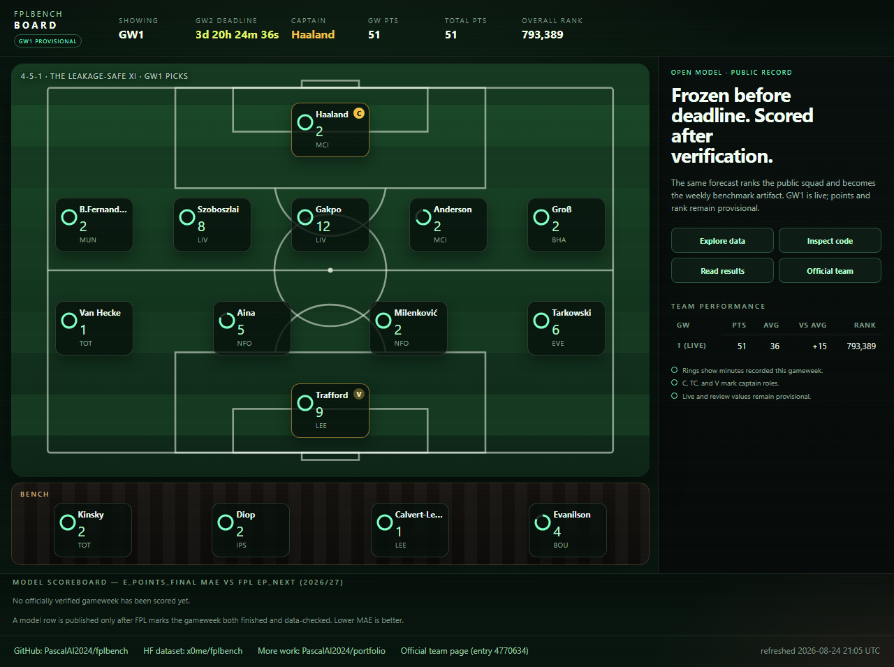
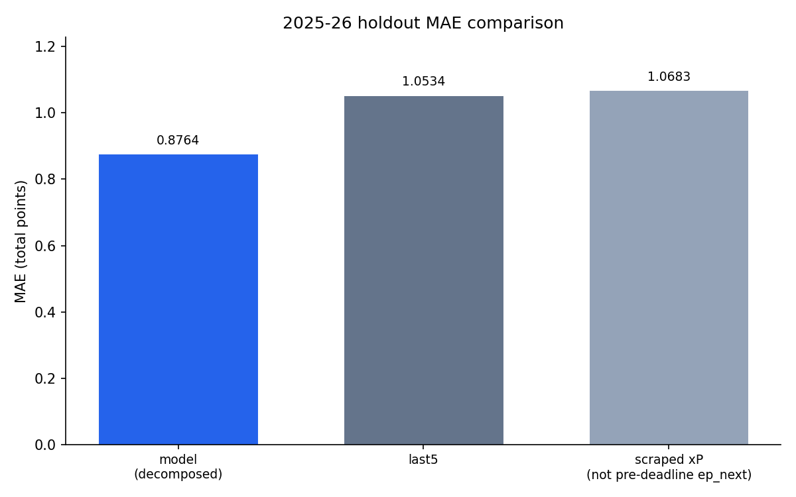
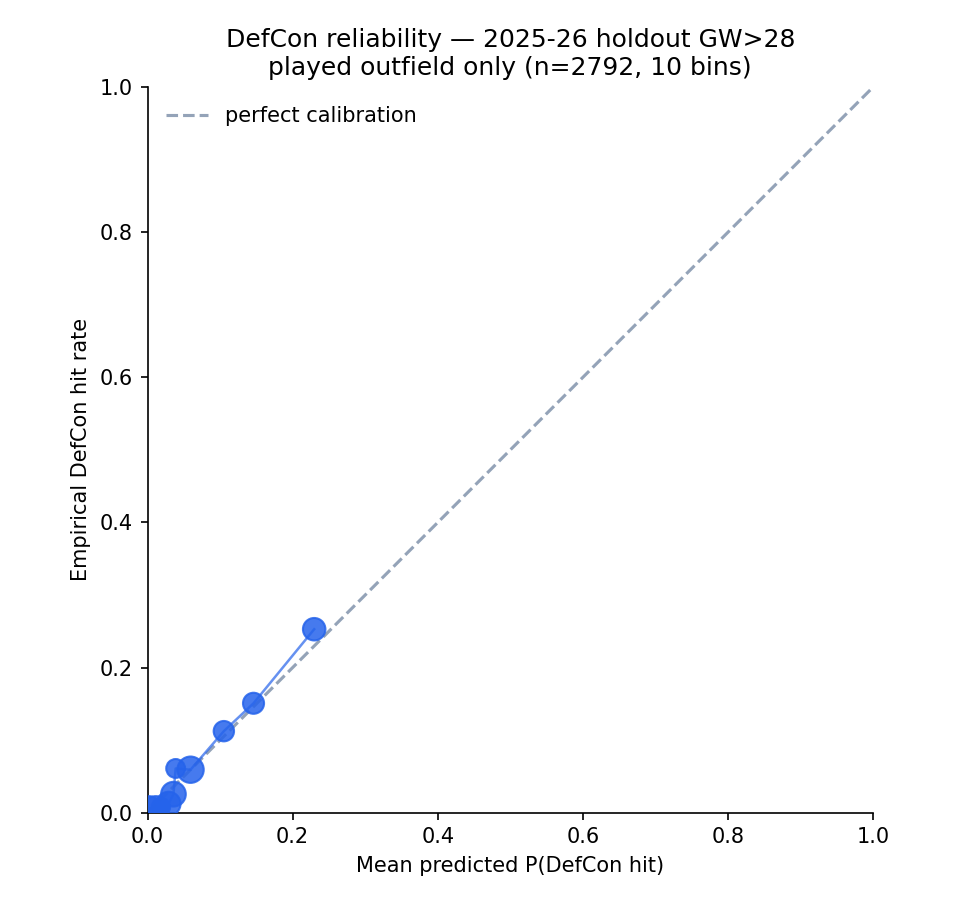
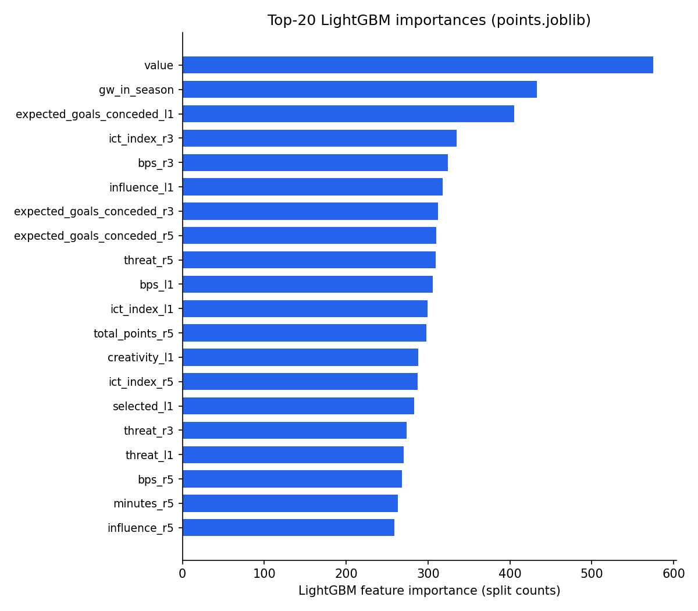

<p align="center">
  <a href="https://huggingface.co/spaces/x0me/fplbench-board">
    
  </a>
</p>

# fplbench

[](https://github.com/PascalAI2024/fplbench/actions/workflows/quality.yml)
[](https://github.com/PascalAI2024/fplbench/actions/workflows/fplbench.yml)

Leakage-aware Fantasy Premier League player-fixture data, reproducible
LightGBM forecasts, and a public post-gameweek scoring record.

[Live board](https://huggingface.co/spaces/x0me/fplbench-board) ·
[Dataset](https://huggingface.co/datasets/x0me/fplbench) ·
[Results](RESULTS.md) ·
[Current work](CURRENT_WORK.md) ·
[macOS setup](docs/MAC_SETUP.md) ·
[Frozen forecasts](outputs/predictions/) ·
[Portfolio](https://github.com/PascalAI2024/portfolio)

The operating contract is simple: generate and commit the forecast before the
deadline, run the model's squad, then grade `e_points_final` only after FPL
marks the gameweek both `finished` and `data_checked`.

```python
from datasets import load_dataset

ds = load_dataset("x0me/fplbench")
train, validation = ds["train"], ds["validation"]
```

---

## Why this exists

FPL models are easy to evaluate badly. Same-gameweek statistics can leak the
answer, double-gameweek fixtures can contaminate each other's lags, and a live
score can move while FPL reviews the event. This project makes those boundaries
testable and public. It models minutes, points, and Defensive Contribution
(DefCon), publishes the historical panel, and exposes its live record.

---

## Holdout metrics (2025-26)

First-party historical holdout evidence, rebuilt after the DGW lag repair.
Common mask: `total_points`, `pred_points`, last-5 baseline, and `xp_scraped`
all finite. Source: [`outputs/models/val_metrics.json`](outputs/models/val_metrics.json).

| Metric | Value | Notes |
|--------|------:|-------|
| **n_common** | 29,417 | rows in the fair comparison |
| **mae_decomposed** | **0.8764** | **published** score (`pred_points_decomposed`) |
| mae_model | 0.9734 | raw points head |
| mae_last5 | 1.0534 | rolling last-5 baseline |
| mae_xp_scraped | 1.0683 | post-match `xP` (not a feature) |
| mae_model_gw1 | 1.4352 | GW1-only cold start |
| defcon_auc | 0.8193 | DefCon hit probability (holdout) |
| defcon_logloss | 0.1942 | after OOF isotonic calibration (raw 0.2488) |
| defcon_brier | 0.0528 | after OOF isotonic calibration (raw 0.0562) |

`pred_defcon` is isotonic-calibrated on 5-fold OOF probabilities from 2025-26 GW ≤ 28 (537 positives). Holdout metrics use GW > 28 only.

Published ranking uses:

```text
pred_points_decomposed = pred_points * clip(pred_minutes / 90, 0, 1)
e_points_final         = pred_points_decomposed + 2 * pred_defcon
e_points_p90           = decompose_points(pred_points_p90, pred_minutes) + 2 * pred_defcon
```







---

## Archived TabFM side study

This pre-repair experiment used the same 2,500 validation rows, 94-feature
context, and stratified sample. It is retained for provenance, not presented
as a result from the corrected DGW-safe pipeline. Source:
[`outputs/predictions/tabfm_vs_lgbm.json`](outputs/predictions/tabfm_vs_lgbm.json).

| Model | MAE (all) | MAE played (n=946) | MAE haulers (n=236) |
|-------|----------:|-------------------:|--------------------:|
| **TabFM** | **1.412** | **2.326** | **4.805** |
| LightGBM (same context) | 1.466 | 2.541 | 4.942 |
| last-5 baseline | 1.107 | 2.420 | 5.020 |
| xp_scraped | 1.115 | 2.816 | 6.687 |

**Caveat:** weights are [`google/tabfm-1.0.0-pytorch`](https://huggingface.co/google/tabfm-1.0.0-pytorch) under **tabfm-non-commercial-v1.0** (research only — not for commercial use). The production path in this repo is LightGBM; TabFM is a side comparison.

Corrected full-validation LightGBM holdout (for context):
`mae_model=0.9734` on 29,747 rows. The common-mask table above remains the
published comparison.

---

## Reproduce

CBC must be installed as a native executable on `PATH`; the optimizer uses
PuLP's `COIN_CMD` rather than PuLP's bundled solver.

```bash
brew install cbc  # macOS; Ubuntu package: coinor-cbc
pip install -e .
python scripts/build_all.py
pytest
```

Writes `data/processed/panel.parquet`, `outputs/models/*`, and validation metrics.
Optional: `pip install -e ".[dev]"` if you want an explicit dev extra. See the
[portable macOS guide](docs/MAC_SETUP.md) for an isolated virtual environment,
Apple Silicon verification, and safe troubleshooting.

---

## Leakage rule

vaastav `xP` is scraped from FPL `ep_this` **after** the gameweek. Managers did not have it at the deadline.

- Stored as `xp_scraped`
- **Never train on it**
- Used only as a contaminated baseline

Every performance feature is shifted inside `(season, player_code)`. In a
double gameweek, both fixture rows receive the same lag values that were known
before the gameweek's first fixture; the second fixture cannot observe the
first. Feature names end in `_l1`, `_r3`, `_r5`. Live comparison uses
pre-deadline `ep_next`, also never fed to the model.

Live scoring now enforces the same season and gameweek boundary. GW1 can use
the immediately preceding season's known form. From GW2 onward, rolling
player and opponent features come from completed current-season fixture rows;
prior-season aggregates and set-piece orders remain separate priors. Live
fixture selection targets the bootstrap's next event exactly. Unsupported
blank or double gameweeks fail explicitly.

`download_live()` writes `data/raw/live/snapshot_manifest.json`, binding the
bootstrap and fixture JSON bytes to their official sources, configured season,
and UTC capture time. Scoring rejects snapshots older than 24 hours, snapshots
observed after its cutoff, and generation at or after the target deadline.

Mid-season scoring additionally requires an offline, previously authorized
official history bundle; the scoring code does not download player histories:

- `data/raw/live/history.csv`: official per-fixture history with `element`,
  `fixture`, `round`, `kickoff_time`, `was_home`, and the raw statistics used
  by the saved model's lag features. Stable codes, positions, clubs, and DefCon
  labels are derived after fixture/element alignment is checked.
- `data/raw/live/history_manifest.json`: `format_version: 1`, `season`,
  `source: "https://fantasy.premierleague.com/api/element-summary/"`,
  `captured_at_utc`, `history_sha256`, `bootstrap_sha256`, `fixtures_sha256`,
  `covered_element_ids`, and `history_rows_by_element`. The last field records
  each original response's row count, with element IDs as string keys.

The manifest covers every current element, including verified empty histories.
Original response counts detect omitted zero-minute fixtures; cumulative
minutes, starts, and points cross-check coverage against the exact bound
bootstrap. They are not substituted for rolling features. Included records
must precede the target GW and both capture times, match fixture dates/events,
and have both official fixture completion flags. Conflicting duplicates,
missing scoring fields, or incomplete coverage stop inference. A missing bundle
never falls back to last-season rolling form. Boundary regressions are in
[`tests/test_live_history.py`](tests/test_live_history.py); current engine
status is in [`CURRENT_WORK.md`](CURRENT_WORK.md).

---

## DefCon labels

Official 2025/26–2026/27 rule (live API):

| Position | Count | Threshold | Points |
|----------|-------|-----------|--------|
| DEF | CBIT | 10 | 2 |
| MID / FWD | CBIT + recoveries | 12 | 2 |
| GK | — | never | 0 |

---

## Frozen GW1 squad

Legal 15-man squad from `outputs/predictions/gw1_2026-27.csv` (£100.0m, ≤3/club, 2/5/5/3), maximizing `e_points_final`.

| | |
|--|--|
| **Cost** | £100.0m |
| **Σ e_points_final** | 78.923 |
| **Captain** | Haaland |
| **Reproduce** | `python scripts/pick_squad.py` |

Full XI, bench, and constraint check: [`outputs/squad_gw1.md`](outputs/squad_gw1.md). Pitch board: [`docs/wow/gw1_pitch.html`](docs/wow/gw1_pitch.html).

The current GW1 prediction file is byte-identical to the forecast first
committed [before the deadline](https://github.com/PascalAI2024/fplbench/commit/4b970a812deb997d32e48f9e48d9520b6a5ab901).
Git history also preserves a post-deadline overwrite and the
[explicit restoration](https://github.com/PascalAI2024/fplbench/commit/2981de109ce7b57f8ccc75ed1c011eb16886fc3a).
The current freeze guard rejects post-deadline overwrites of an existing board.

---

## Dataset / Space / Live team

| Artifact | Link |
|----------|------|
| Dataset | https://huggingface.co/datasets/x0me/fplbench |
| Responsive benchmark board | https://huggingface.co/spaces/x0me/fplbench-board |
| Portfolio | https://github.com/PascalAI2024/portfolio |

The published squad is represented by *The Leakage-Safe XI*. Its account
identifier stays in private runtime configuration; the public board carries
only the sanitized saved-state observation. Points and rank remain provisional
until FPL completes its review, which the public board labels explicitly.

The corrected export contains **139,029 rows and 165 columns**: 109,282 train
rows and 29,747 validation rows. Its fixture key, same-GW lag contract, schema,
row counts, and SHA-256 hashes are recorded in `manifest.json`. Weekly scoring
of the published `e_points_final` forecast vs FPL's own `ep_next` lands in
[`RESULTS.md`](RESULTS.md) only after official verification.

---

## Limitations

| Limit | Detail |
|-------|--------|
| **GW1 cold start** | `mae_model_gw1 = 1.4352` — no in-season form yet |
| **One DefCon season** | Labels only from 2025-26; classifier train uses GW ≤ 28, holdout GW > 28 |
| **Live DGW not implemented** | Historical DGW lags are safe; live double-gameweek prediction still raises `NotImplementedError` |
| **TabFM non-commercial** | `google/tabfm-1.0.0-pytorch` — research license only |
| **Set-piece orders** | `penalties_order`, `corners_and_indirect_freekicks_order`, `direct_freekicks_order` exist in vaastav `players_raw.csv` for 2021-22…2025-26, but those files are **end-of-season snapshots**. Features use **prior-season** orders by `player_code` (first season / new players → 0). Live 2026-27 uses 2025-26. Same-season snapshot values are never treated as known mid-season. |

---

## Data & splits

| Source | Role |
|--------|------|
| [vaastav](https://github.com/vaastav/Fantasy-Premier-League) 2021-22 … 2025-26 `merged_gw` + `players_raw` | historical panel; set-piece orders are prior-season only (see Limitations) |
| Official FPL API | live prices, news, fixtures, `ep_next`, event-live actuals |
| [olbauday/FPL-Core-Insights](https://github.com/olbauday/FPL-Core-Insights) | planned join (cups, Elo, GW0 friendlies) |

| Split | Seasons | Use |
|-------|---------|-----|
| train | 2021-22 … 2024-25 | fit points + minutes |
| validation | 2025-26 | first full DefCon season |
| live | 2026-27 | weekly API scoring → `RESULTS.md` |

**Cite vaastav** if you use the panel. Player data is owned by the Premier League / its providers. Research and personal modelling only.

---

## Layout

```text
fplbench/           # package (panel, train, predict, score, squad)
scripts/
  build_all.py      # full rebuild
  predict_live.py   # live GW board
  score_gw.py       # → RESULTS.md
  pick_squad.py     # ILP 15-man
  compare_tabfm.py  # TabFM side study
  make_charts.py    # → docs/img/*.png
  make_wow.py       # → docs/wow/gw1_pitch.html
  make_social.py    # → docs/img/social.png
RESULTS.md          # verified GW model scores + provisional team rows
outputs/models/     # joblibs + val_metrics.json
outputs/predictions/
docs/img/           # charts + social.png (pitch-board preview)
docs/wow/           # GW1 pitch board
```

Live score after a finished and data-checked GW:

```bash
python scripts/score_gw.py --gw 1 --preds outputs/predictions/gw1_2026-27.csv
```

## Deadline and lineup operations

GitHub Actions owns the public-data loop: the existing Thursday/Friday jobs
create pre-deadline forecasts, while the post-gameweek jobs score only
officially finished and data-checked events. The freeze guard makes repeated
pre-deadline publication safe and rejects an overwrite after the cutoff.

Account actions are deliberately separate from CI. The three legacy Windows
scheduled tasks are disabled. When an operator uses a Codex deadline routine,
there must be only one self-rescheduling occurrence per gameweek, set from the
official deadline rather than a second polling schedule. It may act only in
the approved window and must read back the saved state before recording
success.

The repository never stores login credentials. Transfers, chips, hits, and
lineup changes require the current authorization and experiment rules; the
default experiment remains model-selected free transfers, no points hits, and
no chip unless a separate approval explicitly changes that rule. Operational
state belongs in a sanitized `outputs/progress/` record, while actual scores
remain absent until official verification.

## NFLBench feasibility spike (local)

The repository also contains an isolated, non-live NFL player-week research
slice. It validates point-in-time cutoffs, rejects same-week outcome leakage,
retains frozen DNPs as zero-point outcomes, computes fixed PPR targets, builds
EWMA/position-median baselines, and hashes canonical forecast artifacts.

```bash
python scripts/build_nflbench_sample.py
```

See [`docs/NFLBENCH.md`](docs/NFLBENCH.md). The deterministic sample uses only
synthetic fixtures. It does not scrape NFL.com, use paid data, publish, or
claim real model performance.
